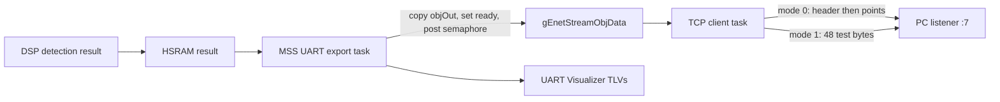

# 11 - Ethernet stream: current implementation

This page describes the **current MSS TCP client**, not the planned plasma record handoff in [07_data_handoff.md](07_data_handoff.md). The board is a TCP client. The PC must listen on port **7** before `enetStreamCfg` is sent. In the local setup, the board reports `192.168.1.200` and the PC Ethernet interface is `192.168.1.10`.

The Ethernet producer in `Radar_Program_mss/utils/RadarSetup.c` copies `result->numObjOut` and `objOut` into the MSS buffer only when `ready == 0` and the object count fits the allocated array. It then sets `ready = 1` and posts `objDataSemaphoreHandle`. The TCP task in `utils/enet_tcpclient.c` waits on that semaphore, sends the selected format, and clears `ready`. If the prior result is still pending, the producer skips that Ethernet handoff; there is currently **no drop counter**. The UART output continues even when the Ethernet buffer is busy.

## Ethernet setup on the PC

Following the TI Ethernet setup procedure: connect and power the board, then enter `queryLocalIp` on its CLI UART to read the board address (currently `192.168.1.200`). In Windows, use `ipconfig` to identify the PC's wired Ethernet adapter, then open that adapter's **Internet Protocol Version 4 (TCP/IPv4) Properties** and set a different static address on the same subnet: `192.168.1.10` with subnet mask `255.255.255.0` in this setup. Verify the link with `ping 192.168.1.200`. Start the PC TCP listener on `192.168.1.10:7` before enabling the stream on the board.

## CLI sequence

1. Load and run the firmware on both cores. Start a PC TCP listener bound to `192.168.1.10:7` (use the actual PC Ethernet address if different).
2. On the **CLI UART** (COM6 on the development PC, 115200 baud), send `sensorStop` if the sensor is running, followed by the full radar configuration.
3. Before `sensorStart`, send `enetStreamCfg 1 192 168 1 10`. The four address arguments are the **PC listener's** IPv4 octets. The command is ignored if the sensor is already started. `scripts/cfg/plasma_capture.cfg` includes this command immediately before `sensorStart`.
4. Send `sensorStart`. `queryLocalIp` prints the board's Ethernet address. `queryDemoStatus` prints the sensor state (`2` means started in this firmware).

`enetTestMode` selects the payload on the next queued radar result; it does not require a sensor restart:

| CLI command | Result |
| --- | --- |
| `enetTestMode` | Print the current mode. |
| `enetTestMode 0` | Cartesian stream (default after boot). |
| `enetTestMode 1` | Repeating 48-byte test pattern. |

The mode command controls the TCP sender after a connection exists. It does not initiate or repair a TCP connection. The Linux `scripts/radar_cli.sh` sends configuration lines over the CLI UART; it is not a TCP listener. `scripts/live_plot.py` reads processed TLVs on the **separate data UART**, not this TCP stream. Raw ADC in `plasma_capture.cfg` is enabled on **LVDS** for DCA1000 capture; the current TCP modes do not send raw ADC.

## Bytes on the TCP stream

| Mode | Bytes written for one queued result | Interpretation |
| --- | --- | --- |
| Cartesian (`0`) | First write: `uint32_t numObj` followed by `uint16_t dummy` (`0x0002`), **6 bytes**. Second write: `numObj * sizeof(DPIF_PointCloudCartesian)` bytes. | Each point is four little-endian 32-bit floats: `x, y, z, velocity` (16 bytes). The sender skips a result with `numObj == 0`. The legacy format has no magic or sequence number. |
| Test (`1`) | One `netconn_write()` of **48 bytes**. | Fixed byte pattern `00 01 02 ... 2F`, repeated once per queued result. Its length equals `sizeof(Plasma_Record)`, but it is **not a serialized Plasma_Record** and contains no live plasma fields. |

TCP is a byte stream: either write may be split or coalesced into TCP segments. A Cartesian receiver must read exactly 6 header bytes, decode `numObj`, then read exactly `16 * numObj` payload bytes. It must not treat a single `recv()` or Wireshark packet as a complete record. The test pattern has fixed length but no framing for resynchronization after a lost starting offset.

## What changed and why

- Removed `NETCONN_DONTBLOCK` from the Cartesian `netconn_write()` calls. With nonblocking writes, the 6-byte header could be accepted while the following point write failed with `ERR_MEM`. That left a valid object count on the wire without its coordinates. Blocking `NETCONN_COPY` writes restored the observed Cartesian payload. A return value is still checked for each write.
- Added a capacity and `ready` check before the MSS copies a new point cloud. Busy or oversized Ethernet results are skipped without aborting the remaining UART TLVs.
- Added the runtime `enetTestMode` CLI hook and `plasma_enet_test.c`. Mode 1 isolates TCP transport with known bytes; mode 0 preserves the Cartesian format.

The Cartesian sender still uses **two** writes. A successful header write followed by a failed payload write can still desynchronize a receiver. The sender connects only once and has no reconnect loop or drop/error counters. A real `Plasma_Record` producer and consumer are not connected to this TCP path yet.

## Current diagnostic checkpoint

In one local run, a PC listener was active on `192.168.1.10:7`; the board reported `192.168.1.200` and answered ping. The CLI acknowledged `enetStreamCfg 1 192 168 1 10`, and `sensorStart` returned `Done`, but that listener saw **no TCP connection**. CLI acceptance and link reachability alone do not prove `netconn_connect()` succeeded. In a later test, the received hex was exactly `00 01 ... 2F`, confirming one complete mode-1 payload reached the PC. Connection behavior should still be checked on each run; the sender has no reconnect loop.
